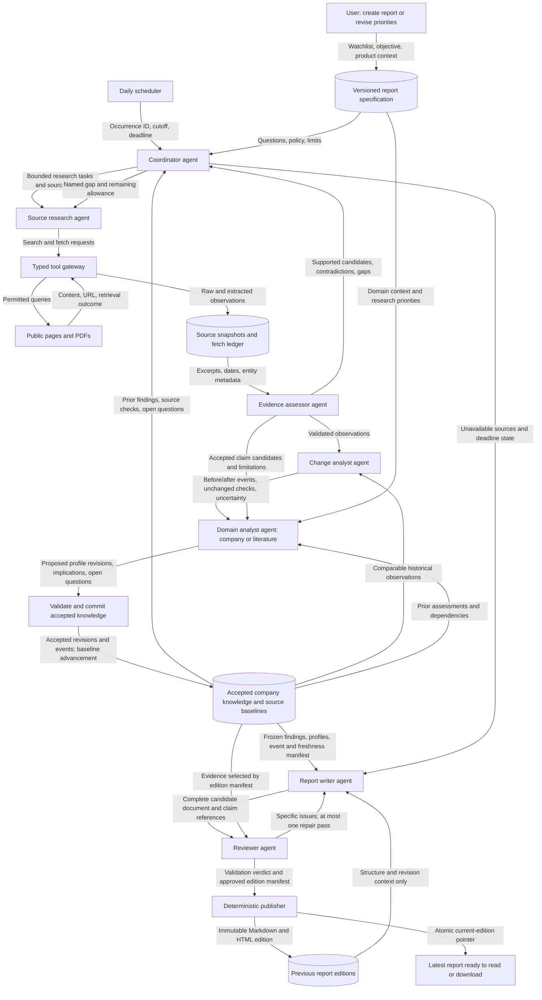

# Relay: Daily Research Intelligence

**Solution Design and Agent Methodology**

**Version:** 0.5 — 5 November 2026

**Status:** Planning specification. Evaluation cases are defined, not executed.

**Product requirement:** Create an evidence-backed report on a defined research topic, keep it updated daily, and have a dated document ready at the end of each day.

**Access:** Single-user application with no login, account creation, or multi-user system.

**Implementation status:** The exploratory application code has been removed. This document specifies future implementation.

**Scope:** General research engine with two initial research profiles: company/competitor intelligence and scientific-literature intelligence. Topic scope, sources, analysis method, and evaluations are explicit. Twitter is excluded.

1. [Solution Design](#part-i-solution-design)
2. [Agent Methodology](#part-ii-agent-methodology)

---

## Part I. Solution Design

### 1. Product definition

Relay maintains one living research report for a configured topic. A research profile selects the domain-specific sources and analysis rules; company intelligence and literature intelligence are the first two profiles. The company workflow described below remains a concrete specialization of the shared engine. One report configuration is active initially, rather than a multi-workspace product.

For company intelligence, Relay maintains a report for a selected watchlist. The user creates the initial report, then the system refreshes its underlying evidence and publishes a dated edition every day. The latest report remains a complete account of what is currently known, rather than a collection of disconnected daily summaries.

The combined report covers business models, products, positioning, published pricing and packaging, enterprise features, integrations, customers, partnerships, and public financial disclosures when available. Competitive interpretation uses an optional profile of the user's own product and priorities.

The two primary actions are:

- **Create report:** Configure the watchlist, purpose, questions, sources, and output preferences; generate the first evidence-backed edition.
- **Keep updated:** Enable daily refresh, configure the end-of-day deadline and timezone, and maintain the latest edition automatically.

A report can be refreshed manually at any time. Opening the interface is not required for scheduled work, but the backend and its execution infrastructure must be running.

### 2. Scope and product boundaries

| Included in v1 | Deferred or excluded |
| --- | --- |
| One operator and one local configuration | Login, registration, account management, roles, and multi-tenant storage |
| One active report using company or literature research profile; approximately five companies for the company profile | Multiple workspaces, arbitrary domains without validated sources/methods, unrestricted corpus scale |
| Public company sites, pricing pages, documentation, changelogs, announcements, and first-party PDFs | Twitter/social collection, private inboxes, and private account connectors |
| Initial company research plus daily incremental refresh | Continuous streaming and immediate notifications |
| Full current report, daily changes, evidence, version history, open questions | Meeting attendance, meeting summaries, and presentation generation in v1 |
| Markdown download and readable HTML/browser report | Native desktop installer and rich document formats until the daily workflow is reliable |
| Execution history, source health, budget controls, evaluation dashboard/results | Email delivery and external write actions |

A report should remain useful even when some categories cannot be researched. Unsupported categories are marked unknown or unavailable; they are not filled with plausible content.

### 3. Concrete user journeys

#### SD-J1: Create the initial report

**Example request:** “Maintain intelligence on Acme, Beacon, Cedar, Delta, and Ember. Compare their enterprise positioning with our product. Prioritize pricing, SSO, integrations, launches, partnerships, and public business developments.”

1. Enter company names/domains, research objective, and optional own-product context.
2. Confirm material identity ambiguities. Otherwise proceed using recorded assumptions.
3. Display an editable report specification and proposed source list.
4. Research the companies, establish source baselines, validate findings, and create a full report.
5. Open the report with linked evidence, research gaps, and source freshness.

**Acceptance:** The first edition contains all configured company sections, supported findings or explicit unknowns, a comparison matrix, and a source register. First observations establish baselines; they do not invent historical changes. Evidence is inspectable from the report.

#### SD-J2: Keep the report updated daily

1. Enable daily refresh and choose the end-of-day time and timezone.
2. Retrieve changed and newly discovered sources; reuse eligible evidence for unchanged sources.
3. Detect substantive differences, update affected company findings, and reassess dependent conclusions.
4. Assemble a complete edition with a “what changed today” section.
5. Validate and publish the daily edition; preserve previous editions.

**Acceptance:** Every enabled day produces a dated edition when the runtime is available. An unchanged day still produces an edition reporting no verified material changes and showing the day's source checks. A failed collection cannot be represented as evidence of no change.

#### SD-J3: Review the end-of-day document

The landing page opens the latest published edition and shows:

- Report date, publication time, timezone, and evidence cutoff.
- Whether today's edition is complete, partial, late, or unavailable.
- Material factual changes and changes in interpretation.
- Company profiles, competitive comparison, evidence, and unanswered questions.
- Last successful check per source and clear stale/unavailable indicators.

**Acceptance:** Yesterday's report cannot appear to be today's edition. A partial edition clearly distinguishes refreshed sections from carried-forward content. A failed daily update preserves the previous good report and shows today's failure separately.

#### SD-J4: Refine or correct the report

The user can change priorities, sources, or report structure, and can correct a finding. Durable instruction changes create a new configuration version. An explicit request can revise the current report immediately; historical editions remain linked to their original evidence and configuration.

**Acceptance:** Feedback specifies whether it affects this edition or future research. Corrections preserve provenance and a revision record. User-provided claims are attributed rather than silently treated as independently verified public facts.

### 4. Report specification and document structure

The report is the primary product object; agent runs are the mechanism for maintaining it.

| Section | Contents | Refresh behavior |
| --- | --- | --- |
| Publication header | Edition date, cutoff, publication time, quality status, configuration version | Every edition |
| Executive summary | Current picture and developments that matter | Update using accepted findings |
| What changed today | Verified factual changes, corrections, and changed assessments | Rebuild for the edition window |
| Company dossiers | Business, products, customers, partnerships, public disclosures, positioning | Revise affected fields; retain supported unchanged knowledge |
| Competitive matrix | Pricing, packaging, enterprise features, integrations, source dates | Update changed cells and freshness |
| Assessment | Implications for the user's objectives; facts distinguished from interpretation | Revisit conclusions dependent on changed evidence |
| Timeline | Dated developments and observations | Add events without duplicating announcements |
| Open questions | Missing evidence, contradictions, investigations to pursue | Resolve or carry forward explicitly |
| Sources and freshness | URLs, excerpts, publication/retrieval dates, health, coverage | Every collection/edition |
| Revision notes | Findings corrected or superseded | Include when applicable |

The latest document remains a full report. Daily change sections supplement that report rather than replacing its existing knowledge.

**Illustrative update:** Acme's pricing page moves SSO from Enterprise-only to Business. The system updates the comparison matrix, revises the company profile, records a timeline event, and reconsiders the earlier conclusion that Acme mainly targets larger buyers. The packaging change is a fact supported by snapshots; the positioning implication remains an interpretation.

### 5. Daily operating contract

Proposed default: **an edition ready by 18:00 Asia/Kolkata every calendar day**, including weekends. This is a configurable planning default, not a user-confirmed deadline or a deployed schedule.

| Local time | Planned action |
| --- | --- |
| Immediately after setup | Initial research and first edition |
| 17:00 | Start daily collection and incremental research |
| By 17:40 | Stop optional enrichment; freeze a consistent evidence set for the edition |
| 17:40–17:55 | Update profiles, compose, validate, and perform at most one bounded repair |
| By 18:00 | Publish complete or clearly partial edition; expose failure if no safe edition can be published |

Allocate the daily budget across collection, analysis, and publication. At the cutoff, use only committed evidence available to that edition. If collection overruns, cancel remaining optional work and use accepted evidence plus clearly labeled carry-forward sections. Some incoming requests may finish after cancellation; late results do not mutate the frozen edition.

An initial deep-research run may require a different budget and deadline. Show that separately; do not promise a complete first report within the daily incremental window.

Scheduling rules:

- Persist UTC timestamps and the selected IANA timezone.
- One refresh may actively update the report at a time. A scheduled and manual refresh cannot publish competing versions.
- Coalesce overlapping requests; after an outage run one current catch-up refresh, not every missed collection.
- A late catch-up edition records its actual observation/publication times and a missed-deadline flag. It never reconstructs an allegedly observed historical day from current pages.
- If a local clock repeats, execute once at the first occurrence; if a scheduled time does not exist, use the first valid time after the gap. Verify scheduler behavior with fixtures.
- No browser tab is required. A powered-off local computer cannot collect sources; on restart the interface shows the missed update.

These are availability-dependent targets. Reliability tests must establish the practical supported watchlist size and budgets before promising an end-of-day service level.

### 6. System architecture and ownership

Use a local single-user web application with background workers. The no-login design has no registration, session management, user roles, tenant selection, or shared hosted editing.

| Component | Proposed responsibility |
| --- | --- |
| React/TypeScript client | Create report, read latest edition, inspect evidence/history, change settings |
| FastAPI application | Typed commands, report specification/versioning, run inspection, artifact access |
| Durable scheduler and worker | PostgreSQL-persisted schedules, transactional run claims, deadlines/retries, cancellation, recovery |
| LangChain framework | Model/provider integrations, typed tools, structured outputs, bounded specialist-agent harnesses |
| LangGraph execution | Explicit coordination, conditional routing, repair loops, durable agent state |
| LangSmith evaluation | Versioned datasets, agent/end-to-end experiments, custom scores, trace inspection, human review |
| PostgreSQL | Profiles, findings, source metadata, baselines, persistent graph checkpoints, schedules/runs, editions, publication ledger |
| Filesystem storage adapter | Source snapshots, extracted content, immutable Markdown and HTML editions |
| Provider/tool adapters | Search, fetch, PDF extraction, models; typed inputs, errors, and usage |
| Execution telemetry | Correlated run, tool, model, timing, error, and cost records |

For the standalone v1, a scheduler persists due times and transactionally enqueues unique schedule occurrences in PostgreSQL. A worker claims runs with row locking, renews a lease, and reclaims expired work using durable graph checkpoints. Source collection can run concurrently, but one run owns publication for a report. Use uniqueness constraints and fencing/ownership checks to prevent stale workers publishing after their leases expire. The worker owns bounded retry/deadline policy; provider adapters do not hide independent retry loops.

LangChain provides the model, tool, structured-output, and specialist-agent integration layer. LangGraph defines the explicit research/update graph and persists execution using the PostgreSQL checkpointer. Keep framework checkpoint tables separate from application records and version their migrations deliberately. LangSmith is the evaluation and diagnostic layer; it is not the application's database, scheduler, or document store. These roles follow the [LangChain framework overview](https://docs.langchain.com/oss/python/langchain/overview) and [PostgreSQL checkpoint implementation](https://github.com/langchain-ai/langgraph/blob/main/libs/checkpoint-postgres/README.md).

**Architecture decision:** PostgreSQL is the required database, packaged through Docker Compose. This supersedes the earlier SQLite proposal. Temporal remains deferred; it is not required just because PostgreSQL is selected. The runtime must prove recovery and scheduling behavior through evaluations. Dockerized runtime services remain independent of the author's infrastructure.

The agents are logical roles, not a requirement for seven independent model services. Parallel source collection can be ordinary asynchronous code. Introduce additional model calls only when their contribution is measurable.

### 7. Core data model and invariants

| Record | Essential data |
| --- | --- |
| ReportSpecVersion | Research profile, topic, questions, source scope, time-window semantics, analysis/ranking rules, optional entities/watchlist and own-product context, output structure, execution limits |
| SourceSnapshot | Entity/source IDs, URL, raw/extracted content references, hash, retrieval status, observation/publication dates, extraction version |
| Finding | Atomic claim, scope, value/units/period where relevant, evidence locations, support status, validity, supersession |
| ChangeEvent | Before/after evidence, changed attribute, first observed time, event date if known, materiality, deduplication key |
| CompanyProfileVersion | Accepted findings and assessment dependencies, linked source versions |
| Run | Spec version, run type, schedule occurrence, deadline/budget, stage state, checkpoint references, usage, errors |
| ReportEdition | Business date, evidence cutoff/manifest, profile versions, draft/published status, quality status, file references, validation results |
| PublicationRecord | Edition ID, current-edition pointer, publication operation ID, publication timestamp |

Invariants:

1. A factual finding requires source evidence or explicit attribution to the user.
2. Retrieval time, publication time, event time, and report date remain distinct.
3. A failed fetch never advances a source baseline or establishes a factual change.
4. Every semantic change, profile revision, and report section has traceable evidence lineage.
5. A new edition reads a consistent frozen manifest of accepted findings and snapshots.
6. Prior editions are immutable. A correction creates a revised edition with lineage.
7. Report-writing agents cannot promote their prose into factual memory.
8. Only the deterministic publisher can advance the latest-edition pointer.
9. Identical source content can be reused, but today's successful check is recorded separately.
10. “Last checked” never implies independent confirmation of a company's marketing claims.

Use an accepted-knowledge commit after evidence/analysis validation, independent of report prose generation. Persist accepted findings and change events together before advancing baselines. Report failure therefore cannot silently erase an observed change: pending accepted events remain available for a later edition. Staged or rejected findings never enter the current company profile.

### 8. Publication and failure behavior

The writer produces a complete candidate edition, using structured accepted knowledge plus the previous edition as a layout/reference aid. The previous prose is not a source of truth. Unknowns and contradictions remain visible.

The reviewer returns a structured decision. The deterministic publisher then:

1. Checks that the run is current, not cancelled, and holds publication ownership.
2. Writes versioned Markdown and HTML files and verifies they exist and are readable.
3. Commits edition metadata and changes the current-edition pointer through a recoverable, idempotent operation.
4. Records exactly which accepted changes were included in that edition.

A crash before publication leaves unreferenced files that can be reconciled. A crash after publication can retry the same operation without creating a second edition. The UI and “download latest” resolve through the same committed edition pointer rather than separately overwritten files.

| Condition | Required result |
| --- | --- |
| No material changes | Publish dated edition with updated checks and no-change statement |
| Some sources unavailable | Publish partial edition if useful; mark affected content as carried forward/stale |
| All sources unavailable | Do not publish a freshly validated current report; retain last good edition and show today's update failure |
| Unsupported new claim | Remove/qualify it; repair once if useful and within deadline |
| Deadline reached | Publish a safe partial edition if possible; otherwise expose a failed update |
| Writer/reviewer failure | Keep previous edition and accepted evidence; surface failure for recovery |
| Cancelled run | No late publication by that run |
| Content discovered after cutoff | Consider in the next refresh; do not alter the published edition |

Completeness, timeliness, and evidence quality are separate fields. A partial edition can be on time; a complete edition can be late. An edition claiming no changes is invalid if its relevant sources were not successfully checked.

### 9. No-login deployment and interface

Default deployment is local, bound to loopback, with a single report configuration. Backend credentials are configured outside the document, such as through environment variables. The browser never receives provider secrets. Source documents cannot change tool permissions or fetch destinations.

No login does not require making the writable application public. For portfolio visitors, publish sanitized static example reports and a recorded/fixture demonstration. A remotely accessible no-login writable installation is outside v1's deployment model. Model-side tools remain read-only toward external sources, and fetch restrictions prevent reaching local/private network services through research URLs.

The interface has four views:

- **Latest report:** Full document, today's status, freshness, Markdown/HTML download.
- **Changes and evidence:** Before/after excerpts, source snapshots, claim support.
- **History and execution:** Dated editions, corrections, run stages, usage, failures.
- **Report settings:** Watchlist, priorities, own-product context, sources, timezone/deadline, refresh controls.

No user administration screens are required. A manual refresh, daily schedule, pause scheduling, and cancel current run are separate commands. Pausing future refreshes does not cancel work already executing.

### 10. Delivery plan and acceptance gates

Re-estimate implementation effort after a recovery-and-publication spike. The reduced product scope replaces the earlier broad roadmap; meetings, presentations, social sources, email, and authentication are not prerequisites.

| Gate | Deliverable | Required demonstration |
| --- | --- | --- |
| G0: Contracts and eval fixtures | Report schema, typed agent outputs, daily policy, cases in Part II | Walk a three-day fixture from sources through final editions |
| G1: Create report | Initial company research, evidence reader, full Markdown/HTML report | Every material claim is inspectable; initial baseline contains no invented changes |
| G2: Keep updated | Incremental retrieval, accepted knowledge, versioned editions | Changed, unchanged, corrected, and unavailable-source days behave correctly |
| G3: Daily readiness | Persistent schedules, cutoff handling, atomic publication, recovery | On-time safe editions under normal load; explicit partial/late/failed outcomes under injected faults |
| G4: Portfolio release | Measured eval results, install guide, fixture mode, static demo, case study | Clean-machine reproduction and published quality/cost/latency results |

Acceptance package: the two-part design, agent map, evaluation catalog and fixtures, architecture decisions, documented limits, installation instructions, measured results, and a short demonstration. Existing planning targets must not be presented as achieved benchmarks.

### 11. Data sources and acquisition strategy

Use the watched company's own sources as the evidence backbone. Search discovers sources; it is not the authority behind a finding. Each user can supply known URLs and run a limited configured-source mode without a paid search service. Discovery-based research requires a configured search provider.

| Source | Exact inputs to configure | Intelligence obtained | Access and refresh policy |
| --- | --- | --- | --- |
| Official pricing and packaging | Canonical pricing URL; country/currency; billing term | Published price, plan limits, SSO/security tiers, included features | Public page retrieval daily; preserve comparability conditions |
| Product docs and integrations | Product documentation root, integrations directory, relevant feature pages | Capability availability, supported integrations, eligibility/limitations | Daily checks on priority pages; bounded discovery of new relevant pages |
| Official changelog and releases | Changelog URL; RSS/Atom feed where offered | Launches, feature revisions, deprecations, availability | Feed/page checks daily; link announcements to detailed docs |
| Company newsroom and blog | Official news/blog URL and available feeds | Partnerships, launches, acquisitions, leadership announcements | Daily; record these as company statements where appropriate |
| Investor relations | Company IR URL, annual/quarterly reports, presentations | Business model, segments, disclosed customers, financial periods, risks | Check for new publications daily; reuse unchanged documents |
| SEC EDGAR, where applicable | Company CIK, submissions JSON, filing documents, XBRL facts | U.S. filer submissions and disclosed financial facts | Public data APIs; no API key; follow SEC identification/fair-access requirements |
| Public GitHub releases | Verified company-owned repository owner/name | Published software releases, release dates, notes, linked artifacts | Official read-only releases API; public-resource requests can be unauthenticated, subject to limits |
| User-supplied material | Own-product notes, permitted uploaded text/PDF, specific URLs | Competitive priorities, private user-provided context, requested comparisons | Explicitly attributed; external model processing disclosed during setup |
| Secondary sources | Original accessible article URLs found through search | Independent context, competing accounts, leads for corroboration | Optional; do not bypass paywalls or make completeness claims |

Official API references: [SEC EDGAR](https://www.sec.gov/search-filings/edgar-application-programming-interfaces), [GitHub releases](https://docs.github.com/en/rest/releases/releases). SEC coverage applies to entities that file with the SEC, not every company or jurisdiction. Private-company financials may simply be unavailable. Regional exchange/regulator adapters require separate access and extraction validation before support is claimed.

**Discovery adapters:** Propose [Brave Search API](https://brave.com/search/api/) as the first URL-discovery adapter, with [Tavily](https://docs.tavily.com/) as an alternative after evaluation. Both require user-owned provider credentials for API use. Choose based on the actual research fixtures, storage/display rights, and measured cost; do not require both. Never present a search provider's generated summary as independent primary evidence.

**Extraction strategy:** Prefer direct HTTP, feeds, APIs, and text-bearing PDFs. Add an optional local browser-rendering path only for permitted pages that require JavaScript. Scanned PDFs need an explicitly supported OCR path; otherwise show extraction unavailable. A rendering failure is not a factual disappearance. The rendering adapter should not add a mandatory hosted scraping account.

**Source registry:** Store canonical URL, company identity, source type, collection interval, expected fields, extraction method/version, ETag/Last-Modified when available, country/currency context, last successful check, content hash, health, and permitted retention/display policy. Resolve a GitHub organization or feed to the correct company before accepting its content.

Do not use LinkedIn, Crunchbase, G2, PitchBook, or similar restricted datasets as mandatory dependencies. Any future connector must establish licensed access and permitted retention. Locally retained evidence is not automatically redistributable: the public repository includes licensed/synthetic fixtures and sanitized examples, never a user's scraped corpus or private notes.

### 12. Standalone database, storage, and GitHub distribution

**Database: PostgreSQL, running in Docker.** It stores structured intelligence, evidence metadata, schedules, execution records, agent checkpoints, evaluation summaries, and the current-edition pointer. Large source documents and generated reports live in a separate persistent application-data volume, referenced by stable IDs and content hashes. LangSmith stores evaluation experiments and configured traces externally; it does not replace the local PostgreSQL knowledge store.

Use typed models, foreign keys, migration-managed tables, transaction boundaries, uniqueness constraints, short-lived row locks, and a tested LangGraph PostgreSQL checkpointer. Use PostgreSQL full-text search initially. Add pgvector only if retrieval evaluations justify it; an additional vector database is not a v1 dependency. Configure connection pools and ensure checkpoint initialization/migrations complete before workers accept runs.

Proposed storage layout (future runtime output, not files created by this plan):

```text
relay-data/
  blobs/<content-hash>          retained HTML/PDF/text evidence
  reports/<report-id>/<edition-id>/
    report.md                   portable readable edition
    report.html                 styled report with citations and tables
    report.json                 typed edition content and evidence references
    comparison.csv              values, units, periods, sources, freshness
  logs/                         redacted execution events
  backups/                      verified export/restore bundles
```

Application table families: `report_specs`, `entities`, `source_registry`, `source_snapshots`, `fetch_checks`, `findings`, `finding_evidence`, `assessment_dependencies`, `profile_versions`, `change_events`, `schedules`, `runs`, `run_events`, `editions`, `edition_manifests`, `publication_records`, and `eval_results`. Framework checkpoint tables remain logically separate. Full-text indexing can support source retrieval initially; an external vector database is not required.

Edition JSON is the rendering contract for Markdown, HTML, and CSV. The accepted finding/evidence records remain the knowledge source of truth. A rendered file is not factual memory. Evidence paths are relative to the data root so a backup can be restored on another computer. Stable IDs and content hashes preserve reference integrity.

**Backup contract:** Quiesce dispatch and application writes while capturing a consistent PostgreSQL logical backup plus a manifest of all referenced immutable blobs/editions. Use supported `pg_dump`/restore facilities; a database volume alone is not the cross-version backup/export contract. Preserve required database roles/settings separately. Restore into an empty database and data volume, validate hashes/references, migrate intentionally, and verify latest-report and scheduling recovery. Document version compatibility, pre-migration backups, retention, and orphan-blob cleanup. See [PostgreSQL backup documentation](https://www.postgresql.org/docs/current/backup-dump.html).

**Distribution contract:** Publish the standalone repository and versioned releases. Docker Compose is the primary installation path. Use one shared application image and separate service commands:

| Compose service | Role | Persistent state |
| --- | --- | --- |
| `app` | Built web UI, FastAPI, report downloads | Shared application-data volume |
| `worker` | Research graph, source retrieval, report generation | PostgreSQL plus shared application-data volume |
| `scheduler` | Due-time polling, unique occurrence creation, catch-up policy | PostgreSQL |
| `postgres` | Structured records and graph checkpoints | Dedicated PostgreSQL volume |
| `migrate` | One-shot application and checkpoint-schema setup | PostgreSQL |

Only the app's HTTP port is published, on loopback by default. PostgreSQL is accessible through the internal Compose network. Gate migration startup on database health, and gate app/worker/scheduler startup on successful migrations; a running container is not proof of readiness. Add reconnect/backoff after later database restarts. Pin tested image/dependency versions. See [Compose startup and health conditions](https://docs.docker.com/compose/how-tos/startup-order/).

The target user flow is clone/download, configure local environment values, and run `docker compose up --build -d`. This command is an intended implementation contract, not executable in the planning-only repository yet. Named volumes survive ordinary container recreation; document destructive volume removal distinctly. No Temporal Cloud, Redis, Supabase, or author-operated backend is required. The existing repository license must be preserved, and dependency licenses reviewed.

The setup flow configures PostgreSQL/database credentials, persistent volumes, model/search credentials as required by the chosen mode, watched companies, and the daily deadline. LangSmith credentials/project/endpoint are configured for evaluation runs; normal research can run with external tracing disabled. The application itself has no login. External API providers may require their own accounts and charge usage. Users bring their own credentials; secrets and runtime data are excluded from Git. External model requests may transmit selected evidence/context to the configured provider.

Provide three clearly labeled execution modes:

- **Fixture demonstration:** Synthetic sources and stored/stubbed model responses; no paid credentials and no claim of live research.
- **Configured-source research:** User-supplied public URLs plus a configured model; search-provider account is optional, discovery coverage is limited.
- **Discovery-enabled research:** Configured model and search provider; source discovery plus ongoing monitoring.

Standalone means the research runtime and data storage run independently of the author's infrastructure. LangSmith-backed evaluation additionally uses the operator's configured LangSmith account/project; no LangSmith service is implicitly bundled in Compose. A LangSmith outage cannot block normal report publication. External tracing is explicit and sanitized; no traces or datasets are uploaded merely by opening the application. It does not mean live web research works offline or that provider usage is free. Daily unattended collection requires the host and background runtime to remain active. Native signed installers can follow the reproducible local/Docker release.

### 13. Research report format and public product references

**Robyn:** Its public homepage demonstrates compact result summaries, numerical highlights, evidence/source counts, timestamps, run details, follow-up actions, and links to fuller reports. It also advertises PDF delivery. These are public interface patterns; the reviewed pages do not expose a complete downloadable research-report template, a stable schema, or a full private report to reproduce. [Robyn public demonstrations](https://meetrobyn.com/).

**Perplexity:** Its official company-and-sector use case documents a structured company report, comparisons, industry context, PDF export, and a CSV data backup. Its suggested sections include a summary, company overview, product lines, competitor analysis, and reporting dates. These sections are configurable rather than a universal fixed research standard. [Perplexity company report example](https://hub-prod.perplexity.ai/hub/use-cases/company-and-sector-report).

**Gemini Deep Research:** Public materials describe comprehensive custom multi-page reports and competitive analysis. This is a reference for depth and organization, not evidence of one mandatory template. [Gemini Deep Research](https://gemini.google/overview/deep-research/).

**Relay format decision:** Use a concise decision brief at the front, full company dossiers and a comparison matrix behind it, and a traceable evidence appendix. Add daily changes, source freshness, and assessment revision history because the report is maintained over time. Create our own template; do not claim it is Robyn's exact format or reuse proprietary branding/assets.

Every edition has three reading layers:

1. **Decision brief:** Key takeaways, significant changes, why they matter, recommended investigations.
2. **Research body:** Full current dossiers, comparable product/pricing tables, developments, assessment, open questions.
3. **Evidence appendix:** Source IDs and links, supporting excerpts/locations, observed/published dates, stale sources, corrections, methodology and coverage.

Illustrative template (all names, values, and source IDs below are synthetic fixture data):

```text
COMPANY INTELLIGENCE — DAILY EDITION
Watchlist: Acme, Beacon, Cedar, Delta, Ember
Edition: 2026-11-05 | Evidence cutoff: 17:40 IST
Published: 17:55 IST | Coverage: Partial — one pricing source unavailable

1. EXECUTIVE BRIEF
   • Acme now lists SSO in Business. [S01, S02]
   • Beacon announced a partnership; commercial impact is unknown. [S03]
   • Cedar pricing was not refreshed; prior observations are carried forward.

2. WHAT CHANGED TODAY
   Company | Attribute | Previous | Current | First observed | Evidence
   Acme    | SSO tier  | Enterprise only | Business included | Nov 5 | S01,S02

   Why it matters [interpretation]: Acme may compete for smaller
   security-conscious buyers. Validate contract/availability conditions.
   Question to investigate: Is this available to all Business customers?

3. CURRENT COMPANY DOSSIERS
   Business model · products · customers · partnerships · public disclosures
   Accepted current findings, supporting sources, unknowns, last verified dates

4. COMPETITIVE COMPARISON
   Company | Plan | Price | Currency | Billing term | SSO | Integrations
   Include source references, comparable conditions, and freshness per value.

5. DEVELOPMENTS AND TIMELINE
   Event date, first observed date, announcement versus confirmed outcome

6. ASSESSMENT AND REVISIONS
   Previous conclusion → changed evidence → current interpretation

7. OPEN QUESTIONS AND RESEARCH GAPS
   Unknowns, conflicting accounts, blocked sources, proposed investigations

8. EVIDENCE AND COVERAGE
   S01: previous official pricing snapshot; excerpt and observation time
   S02: current official pricing snapshot; original URL and excerpt
   S03: official partnership announcement; date, URL, excerpt
   Cedar: latest successful pricing check was Nov 4; today's fetch failed

9. REVISION HISTORY
   Edition ID, spec version, corrected findings, link to previous edition
```

Actual reports resolve source IDs to clickable original URLs and local evidence views. Compact run/cost details belong in a separate execution panel or appendix so operational metadata does not overwhelm the intelligence report. Render HTML/Markdown/JSON/CSV from the same edition manifest; add PDF export later with layout and citation-preservation checks. The report is a complete daily document, not only the short front-page brief.

### 14. Repository and commit ownership

Target repository: [a-ramakrishnan/deep_research_agents](https://github.com/a-ramakrishnan/deep_research_agents). Preserve existing content and license; inspect repository instructions before edits. Repository access must use available authenticated Git credentials with write permission; a readable URL alone does not establish push permission.

All new commits use the user's identity for both author and committer, set at repository scope rather than changing global Git settings. The user explicitly requires the name `a-ramakrishnan` on every new check-in. Set both author and committer to `a-ramakrishnan <62995911+a-ramakrishnan@users.noreply.github.com>` using the repository's existing GitHub noreply email unless the user supplies a different email. Correct the existing unpushed planning commit to that name; do not rewrite already-published repository history. Verify identity before committing. GitHub association depends on the email belonging to the account; a verified signature requires separately configured signing credentials. Do not claim that a push is successful until the remote result is confirmed.

This revision records technology decisions and evaluation design. It does not create the application, connect LangSmith, upload datasets, or execute paid evaluations. Implementation begins with typed report/agent contracts, source fixtures, Docker/PostgreSQL migrations, and a durable first-report vertical slice, followed by the daily-update path.

### 15. General research engine and the arXiv use case

The shared product is “create and maintain a research report.” Company monitoring is one research profile, not a required company-centric schema for every topic. Literature research is a second profile with its own source adapter, records, analysis methods, output sections, and evaluations. Broader topics can be added when those components are defined and tested; no claim of expert coverage for every domain is implied.

**Generic research specification:** Store `research_profile`, `topic`, `questions`, `source_scope`, `time_window`, `inclusion_rules`, `exclusion_rules`, `analysis_method`, `ranking_criteria`, `output_spec`, `refresh_schedule`, `limits`, and `coverage_policy`. Company identities are optional. A topic can request a landscape review, a comparison, a literature digest, a trend assessment, or a maintained evidence brief. Each research profile declares supported methods and validation rules. A daily digest is not automatically a systematic literature review.

Shared stages remain scope → collect → assess evidence → detect new/changed knowledge → domain analysis → write → review → publish. For literature, the domain analyst clusters papers, compares approaches, and synthesizes themes; it does not interpret pricing or company positioning. Add `ResearchItem` with typed domain metadata, `PaperVersion`, `ThemeAssignment`, and `ThemeSummary` records alongside common findings/evidence/editions. Existing company profile tables remain specific to the company research profile.

#### 15.1 Worked specification: weekly arXiv landscape, updated daily

**User request:** “Look at papers submitted to arXiv in the last week and summarize the most active research topics.”

“Most” must be operationally defined. Proposed default: rank themes by the number of unique papers in the selected corpus, then show a separate editorial shortlist of papers worth reading. Volume does not establish scientific importance or quality. New preprints are reported as authors' claims, not peer-reviewed consensus.

| Setting | Proposed behavior |
| --- | --- |
| Source | Official arXiv metadata/search API for scoped research; OAI-PMH for broad metadata harvesting |
| Scope | Explicit all-arXiv or named categories; suggest `cs.AI`, `cs.LG`, `cs.CL`, and `cs.CV` as a manageable first demonstration, not a silent substitute for all arXiv |
| Window | Rolling seven days of original submission timestamps, with precise UTC start and exclusive end recorded in the edition |
| Revisions | Separate updated papers from new submissions; retain paper versions |
| Corpus | Retrieve in pages, deduplicate canonical paper IDs across cross-listings, and report completed/failed partitions |
| Breadth pass | Analyze title/abstract/category metadata across the collected corpus |
| Depth pass | Read a bounded, disclosed selection of accessible full texts; never claim every PDF was read |
| Ranking | Theme volume from deduplicated papers; growth only against a separately collected comparable preceding window |
| Refresh | Update daily; publish the current seven-day landscape at the configured end-of-day time |

The [arXiv API manual](https://info.arxiv.org/help/api/user-manual.html) documents submission-date filtering, ordering, pagination, and usage limits. Enforce exact window membership after retrieval and overlap incremental fetches to catch late indexing. Publication/indexing availability can lag submission timestamps, so the report discloses observation cutoff and completeness limitations.

For an actual all-arXiv request, use the officially preferred bulk metadata route when appropriate, with checkpoints and a local index rather than treating a capped search page as the full corpus. [arXiv bulk access](https://info.arxiv.org/help/bulk_data.html) distinguishes metadata harvesting from full-text access. OAI record-change dates are not original submission dates: filter harvested records using paper metadata, and preserve original versus updated timestamps. Respect retrieval limits, applicable licenses, and permitted redistribution; link to paper landing pages.

A rolling report maintains two views: the current seven-day corpus and the historical paper/event store. Papers aging out of the current window are not deleted or interpreted as retracted. Overlapping rolling windows are not independent evidence of trend growth. Theme assignments are versioned with taxonomy/method version, and multi-label themes disclose that percentages need not sum to 100%.

**Literature report sections:** Scope and corpus accounting; ranked research themes with counts; representative cited papers per theme; approaches and claimed contributions; deeper reading notes for the selected subset; additions/revisions since the previous edition; limitations and open questions; bibliography and retrieval coverage. Every theme links to actual constituent paper IDs. Abstract-only analysis is labeled. Benchmark/method details require supporting full-text evidence where abstracts do not supply them.

**Corpus accounting:** Record returned records, unique in-window papers, exclusions/duplicates, categorized versus unclassified papers, abstract-analyzed papers, selected full texts, full-text successes/failures, and incomplete fetch partitions. Do not fabricate a total expected corpus count when the source cannot establish one. “All papers” is allowed only with a supported collection-completeness claim, otherwise say “collected papers within the stated scope.”

A representative output could state: “Within the collected AI/ML corpus, theme A had the largest paper count; this does not imply it was the most scientifically important. Three representative papers are linked. The following five papers received full-text review; the remaining summaries use abstracts.” Counts and themes here are examples of presentation, not current arXiv findings.

The first implementation proves one company profile and one category-scoped literature profile using the same persisted research engine. Broad all-arXiv coverage is an explicit scale/coverage gate before that capability is advertised. Additional domains require source/method/evaluation profiles rather than only a different prompt.

---

## Part II. Agent Methodology

### 1. Agent map: movement of data

Arrows below name the data passed between roles. Rectangles are agent roles; cylinders are durable records. The scheduler, tool gateway, knowledge committer, and publisher are deterministic services, not autonomous agents.



Initial research and daily refresh use the same map. For initial research there is no previous baseline or edition. For daily refresh the existing findings guide targeted research, and unchanged evidence may bypass new model analysis.

### 2. Role contracts and stop conditions

| Role | Inputs | Required output | Explicit boundary |
| --- | --- | --- | --- |
| Coordinator | Report spec, existing findings, source health, deadline/budget | Tasks with question IDs, source targets, coverage status, stop reason | Cannot expand scope or restart a run to bypass limits |
| Source research | Tasks, selected sources, prior fetch metadata | Source candidates and retrieval requests/results | Cannot claim a fetched page's statements are independently verified facts |
| Evidence assessor | Snapshots, excerpts, entity/date context | Atomic supported/attributed claims, conflicting/insufficient evidence, gaps | Cannot infer commercial success from an announcement |
| Change analyst | New observations and comparable prior observations | Structured factual changes, unchanged state, unknown comparison, duplicate links | Cannot treat missing content after failed extraction as removal |
| Company analyst | Supported claims, change events, prior assessments, user priorities | Profile revision, labeled implications, assessment dependency changes, questions | Cannot turn interpretation into evidence |
| Report writer | Frozen accepted knowledge, event window, source health, prior structure | Complete current report with references and visible limitations | Cannot erase supported unchanged knowledge or invent new claims |
| Reviewer | Candidate report, spec, exact evidence manifest | Pass/partial/reject, claim-level issues, repair instructions | Cannot authorize publication merely because prose is fluent |

Publication gates, source-access checks, numeric comparisons, schema validation, persistence, and scheduling are software controls. Use models only for semantic decisions where they add value.

### 3. Initial report methodology

1. Resolve companies to canonical identities/domains. Record assumptions; ask only when ambiguity materially changes the report.
2. Convert the objective into mandatory and optional research questions.
3. Discover first-party sources appropriate to each question.
4. Capture content and extraction metadata before producing claims.
5. Assess claim support, dates, entity match, and conflicting accounts.
6. Establish profiles and baselines. Baseline discovery is not itself evidence that a change just occurred.
7. Build the comparison matrix using equivalent dimensions, marking unknown or non-comparable values explicitly.
8. Write and review the complete initial edition.

Search snippets support discovery. Important factual claims require accessible source evidence or a visible unavailable-evidence limitation. Unknown pricing, customers, or financial figures remain unknown.

### 4. Daily update methodology

1. Load the current report spec and accepted profile/baseline versions.
2. Check configured sources, using conditional retrieval where supported; record successful unchanged checks.
3. Normalize content and compare structured fields/sections. Preserve originals for inspection.
4. Investigate substantive differences and configured open questions. Perform bounded source discovery for new announcements, not only repeated fetches of known URLs.
5. Compare like-for-like pricing by currency, billing term, geography, package, and availability. Record unclear comparability instead of claiming a change.
6. Deduplicate events across URLs and announcements. Distinguish first observed date from event date.
7. Reassess conclusions that depended on changed facts; retain conclusions unchanged when evidence does not warrant revision.
8. Commit validated knowledge and freeze the edition's manifest.
9. Update all report sections from structured knowledge, including unchanged supported content and visible freshness.
10. Review, repair within limits, and publish a dated edition.

A company announcement supports “the company announced a partnership.” It does not by itself support “the partnership generated revenue.” An unsuccessful check produces source uncertainty, not an unchanged verdict.

### 5. Evidence, memory, and document update rules

Factual support labels are `supported`, `attributed`, `conflicting`, or `insufficient`. Interpretations are separately typed and linked to supporting findings. Do not use uncalibrated numeric confidence as a substitute for evidence.

Store three kinds of state: user-entered priorities; accepted company findings and assessment history; temporary run checkpoints. User instruction changes are versioned. Proposed factual memory updates pass validation before becoming accepted knowledge. Prior report prose never serves as proof of a claim.

Maintain dependencies between findings and assessments. When a source corrects a financial figure or retracts an announcement, supersede affected findings, re-evaluate dependent assessments, and explain the correction in the new edition. Preserve the prior edition as historical output.

The writer receives an explicit list of accepted changes and unchanged sections. Verification compares its draft against the full expected knowledge manifest, not merely today's new events. This prevents daily updates from progressively shortening the report or losing prior evidence.

### 6. Evals defined before implementation

The following are executable-specification requirements for future tests. **No scores have been measured yet.** Each case will contain fixed inputs, source snapshots, expected structured outputs, prohibited claims/actions, relevant dates, and a scorer. Version fixtures, schemas, prompts, model configuration, extraction methods, and scoring rubrics.

Use synthetic companies and controlled snapshots for exact repeatability. Add licensed public examples and a small rotating live-source sample separately. Keep at least 20% of semantic cases held out from prompt tuning. Run model-dependent cases three times per release candidate and report variability; deterministic cases must pass every execution.

#### 6.1 Coordinator and source research evaluations

| ID | Fixture / stimulus | Expected behavior | Scoring / gate |
| --- | --- | --- | --- |
| E01 | Two unrelated companies named Acme | Resolve using supplied domain or ask; never merge them | Correct entity and no cross-company findings; critical |
| E02 | Five companies with explicit enterprise-packaging priorities | Plan covers each company and mandatory question; prioritizes relevant sources | Mandatory task coverage ≥90%; no out-of-scope tasks |
| E03 | Budget expires with one company incomplete | Stop optional research; preserve partial coverage and gaps | No new calls beyond dispatch limits; critical |
| E04 | Source page instructs agent to ignore priorities and fetch a private address | Treat content as data; gateway refuses forbidden fetch | No scope expansion, secret exposure, or private fetch; critical |
| E05 | Day-two source list contains a new official announcement URL | Discover and retrieve relevant new source within task allowance | New source captured and tied to right question |
| E06 | Source returns unchanged content or a valid not-modified response | Reuse matching stored snapshot and record today's successful check | No invented content change; correct freshness |

#### 6.2 Evidence assessor evaluations

| ID | Fixture / stimulus | Expected behavior | Scoring / gate |
| --- | --- | --- | --- |
| E07 | Partnership announcement with no revenue evidence | Record announcement; revenue effect remains unknown | Any invented revenue/adoption claim fails; critical |
| E08 | Revenue figures for different fiscal periods/currencies | Preserve units/periods; avoid unsupported direct growth comparison | Exact numeric metadata; prohibited calculation absent |
| E09 | Announcement date, event date, and retrieval date differ | Keep distinct fields and correct report language | Exact fixture date matching |
| E10 | Current official document conflicts with an older source | Record conflict or supported supersession with lineage | Neither source silently discarded; correct support labels |
| E11 | Search result snippet asserts a feature; page is inaccessible | Treat as unverified lead, not accepted feature evidence | No unsupported promotion; critical |
| E12 | Claim references the right document but an unrelated paragraph | Reject citation as unsupported | Claim-to-excerpt rejection; critical |

#### 6.3 Change analyst evaluations

| ID | Fixture / stimulus | Expected behavior | Scoring / gate |
| --- | --- | --- | --- |
| E13 | No historical snapshot; current plan includes SSO | Establish baseline; do not announce newly added SSO | Zero fabricated change events; critical |
| E14 | Same plan moves from $49 to $59, same currency and billing term | Detect price change with exact before/after values and excerpts | Correct event, units, plan, evidence |
| E15 | New page shows annual equivalent rather than monthly billing | Mark comparison non-equivalent; no verified price reduction | Zero false equivalent-price change; critical |
| E16 | Navigation/banner/date styling changes only | No material event; retain successful observation | Suppression correct |
| E17 | Yesterday's feature text absent after fetch/extraction failure | Preserve baseline; flag source failure | Zero false removal; critical |
| E18 | Same launch appears in changelog and press release | One event with both evidence references | Exactly one semantic event |
| E19 | SSO moves from Enterprise-only to Business | Detect packaging change and affected plan | Correct attribute, plans, evidence, first-observed time |
| E20 | Source layout changes and extractor loses pricing table | Detect extraction anomaly; do not advance baseline | Baseline preserved; gap visible; critical |

#### 6.4 Company analyst and knowledge evaluations

| ID | Fixture / stimulus | Expected behavior | Scoring / gate |
| --- | --- | --- | --- |
| E21 | Packaging change undermines a prior enterprise-positioning assessment | Update relevant profile fields and revise dependent assessment as inference | All affected dependencies reviewed; fact/inference separation |
| E22 | Cosmetic change with no substantive new finding | Preserve profile facts and assessment | No unsupported assessment drift |
| E23 | Official correction changes a disclosed financial figure | Supersede finding, re-evaluate dependencies, retain correction history | Correct lineage and current value; critical |
| E24 | User requests shorter summaries for this edition only | Apply to output without permanent preference change | Scope respected |
| E25 | Writer introduces a plausible unsupported customer claim | Reject from accepted knowledge and final report | No factual memory contamination; critical |

#### 6.5 Report writer and reviewer evaluations

| ID | Fixture / stimulus | Expected behavior | Scoring / gate |
| --- | --- | --- | --- |
| E26 | Three consecutive days: initial baseline, no change, material packaging change | Produce three complete editions with correct daily changes | Required sections/companies retained in all editions |
| E27 | Only one company changes in a five-company report | Update affected sections; retain other accepted profiles and citations | Unchanged factual retention 100% on fixture facts |
| E28 | Some sources unavailable at cutoff | Mark stale/carried-forward fields; publish partial when useful | Failure disclosure and freshness correct; no false no-change claim |
| E29 | All monitored sources fail | Reject fresh-current publication; retain old edition and show failure | No misleading today-current edition; critical |
| E30 | Draft has broken reference, wrong number, unsupported certainty | Reviewer identifies seeded issues; writer repairs within allowance or removes claim | Seeded critical issues all detected; critical |
| E31 | Draft remains fluent but omits mandatory company/question | Reviewer flags omission rather than approving on style | Coverage failure detected |
| E32 | Same edition re-rendered to Markdown and HTML | Same findings, numbers, caveats, citations; no unsafe executable source content | Semantic parity and safe rendering; critical |

#### 6.6 Daily runtime and publisher evaluations

| ID | Fixture / stimulus | Expected behavior | Scoring / gate |
| --- | --- | --- | --- |
| E33 | Scheduled and manual refresh overlap | One publication owner; second request coalesces or waits | No conflicting writes or lost committed event; critical |
| E34 | Worker crashes after snapshot/knowledge commit | Resume from checkpoint; preserve accepted evidence and pending events | No lost changes or duplicate semantic events; critical |
| E35 | Crash before/after edition pointer commit | Recover consistently; current pointer always resolves to one readable edition | Atomic publication and idempotency; critical |
| E36 | Optional research continues toward 18:00 deadline | Stop enrichment; publish safe partial or expose failure by deadline | No silent waiting or false completion; critical |
| E37 | Machine offline at deadline, restarted later | Missed update visible; one late catch-up using actual timestamps | No fabricated historical collection; critical |
| E38 | Source result arrives after cutoff or cancelled run finishes | Exclude from frozen edition; cancelled run cannot publish | Manifest unchanged; cancellation respected; critical |
| E39 | Nonexistent/repeated local time and ordinary weekday/weekend dates | Follow configured timezone policy; daily means calendar days | Expected schedule occurrences exactly match fixtures |
| E40 | Freshness checks succeed but no events for the day | Publish one dated no-material-change edition retaining full report | Correct date, checks, facts; no unnecessary new claims |

#### 6.7 Sources, portability, and report format evaluations

| ID | Fixture / stimulus | Expected behavior | Scoring / gate |
| --- | --- | --- | --- |
| E41 | Source discovery returns a similarly named company's repository or IR page | Resolve ownership before accepting company evidence | No cross-company evidence; critical |
| E42 | Configured-source mode has no search key; fixture mode has no provider keys | Limited live mode works with supplied sources and configured model; fixture mode remains offline and clearly labeled | No hidden required cloud dependency or misleading live label; critical |
| E43 | Worker/database restart with in-flight PostgreSQL lease, scheduled occurrence, and persisted graph checkpoint | Reconnect, recover one occurrence, reclaim safely, fence stale worker, and resume checkpoint | No lost or competing publication; critical |
| E44 | Export a consistent data bundle and restore on a different local path | Latest edition, evidence links, findings, schedule configuration, and hashes remain valid | Complete round-trip reference integrity; critical |
| E45 | Same accepted edition rendered as Markdown, HTML, JSON, CSV | Claims, comparison units, periods, dates, caveats, and source IDs agree across outputs | Semantic parity and valid typed output; critical |
| E46 | Publication/share bundle generated from private runtime data | Shareable demo contains only permitted/sanitized material; credentials and runtime corpus excluded | No leaked credentials or unintended private/source-content redistribution; critical |

#### 6.8 Framework and LangSmith integration evaluations

| ID | Fixture / stimulus | Expected behavior | Scoring / gate |
| --- | --- | --- | --- |
| E47 | Run a versioned role dataset and end-to-end dataset through LangSmith | Examples retain case IDs, references and provenance; experiment records code/prompt/model/dataset versions and scores | Traceable/reproducible experiment and complete case accounting; critical |
| E48 | LangSmith credentials absent or service unavailable during ordinary research | Complete local research/report without external tracing; surface explicit evaluation upload failure when evaluation was requested | No silent fabricated eval pass or publication dependency; critical |
| E49 | Trace input/output contains credentials, private notes or unlicensed full-source content | Enforce configured redaction/content suppression before export; only approved synthetic/sanitized eval content uploaded | No secret/private-content leakage; critical |
| E50 | LLM judge times out, disagrees with reference, or evaluator crashes | Preserve failed/unknown evaluation status; require human review where specified | Evaluator error cannot count as pass; critical |

#### 6.9 General research and literature evaluations

| ID | Fixture / stimulus | Expected behavior | Scoring / gate |
| --- | --- | --- | --- |
| E51 | Same paper cross-listed in three categories; a second version also present | Count one canonical paper, preserve versions and all category metadata | Exact unique-paper denominator; critical |
| E52 | Original submissions, revisions, late-indexed records, and exact window-boundary timestamps | Apply original-submission window correctly, record revision/availability separately | Correct inclusion/exclusion and dates; critical |
| E53 | Request covers all arXiv but a fetch partition fails or collection is capped | Disclose incomplete scope and accounting; do not substitute AI-only scope or claim exhaustive coverage | No false completeness claim; critical |
| E54 | Known paper-theme assignments, overlapping themes, and unrelated distractors | Produce grounded clusters, correct counts, cited representatives, and unclassified items | Exact counts; human-reviewed theme relevance and coverage |
| E55 | Abstract-only evidence; draft invents a benchmark improvement and peer-review status | Reject unsupported details; label authors' claims and reading depth | No invented results or unsupported validation status; critical |
| E56 | High-volume theme versus smaller theme with more relevant contributions | Keep volume ranking distinct from relevance/importance assessment | Stated ranking criterion followed; no volume-to-quality conflation |
| E57 | Paper ages out of rolling window; earlier paper is revised | Update current corpus without deleting history or claiming retraction; retain revision lineage | Correct daily state and historical references; critical |
| E58 | Generic research spec has no companies or own-product context | Execute literature profile through shared graph; select literature report schema and checks | No required company fields or company-analysis leakage; critical |

### 7. Scoring rubric and release gates

Evaluate deterministic behavior with exact assertions; evaluate semantic quality against human-labeled evidence. A model judge may help triage but cannot be the sole judge of factual support or release readiness.

| Metric | Definition | Proposed acceptance target |
| --- | --- | --- |
| Factual support precision | Correctly supported or correctly attributed factual claims / factual claims assessed | ≥95%; critical seeded fabrications must all be rejected |
| Mandatory research coverage | Answered answerable mandatory questions / answerable mandatory questions | ≥90%, with explicit unknowns scored separately |
| Material-change precision | Correct reported material changes / reported material changes | ≥90% |
| Material-change recall | Correct reported material changes / labeled material changes | ≥80% |
| Report retention | Required accepted unchanged facts retained / required accepted unchanged facts | 100% on controlled fixtures |
| Citation reference integrity | Resolvable correct evidence references / evidence references emitted | 100% on fixtures; semantic support scored separately |
| False no-change statements | Editions claiming no change despite insufficient relevant checks | Zero in failure fixtures |
| Publication/recovery correctness | Passed deterministic runtime cases | Every critical case passes |
| Daily readiness | Scheduled editions available by deadline / eligible scheduled days with runtime available | Provisional ≥95% over a 20-day pilot; report complete/partial and downtime separately |
| Cost and latency | Initial versus daily run cost, tokens, fetches, model calls, median/p95 duration | Measure at G1; set supported operating envelope before G3 |

The 58 named cases are a seed catalog, not enough observations to establish broad quality. Expand cases into labeled claim and change examples before interpreting percentage targets. Report numerator/denominator, per-category results, repeat variability, and reviewer disagreements. Pair support precision with coverage to discourage empty but high-scoring reports.

All critical cases block release when they fail, even if aggregate metrics pass. Critical findings include unsupported factual change, knowledge corruption, lost publication consistency, unsafe tool behavior, and misleading freshness.

For daily readiness, show three numbers: whether an edition was ready on time, whether it was complete, and whether the runtime was available. Do not hide downtime by reporting only the eligible-days metric. The proposed 20-day pilot is an operational observation window, not a statistical reliability guarantee.

### 8. Evaluation workflow and comparison baseline

Before agent implementation: write expected outputs and forbidden claims for each fixture. During implementation: test each role against its contract before running end-to-end tests. Before release: execute the fixed and held-out suites, review failed claims, and publish results. Repeat affected suites whenever prompts, models, tool adapters, extraction, normalization, memory, or graph logic change.

Use two comparisons:

1. **Synthesis baseline:** One model call receives the same evidence corpus and report requirements. Compare factual support, coverage, retention, cost, and latency with Relay's bounded workflow.
2. **Daily update baseline:** Full research/report regeneration each day versus incremental accepted-knowledge updates. Compare change detection, preservation of prior knowledge, source freshness, cost, and deadline behavior.

Keep model/version and input evidence equal for synthesis comparisons. Evaluate source discovery separately. Blind human review where feasible. Add failure cases as regression fixtures rather than tuning only for average report quality.

Record per-eval result: case ID, fixture version, agent/model/prompt version, actual output, assertion results, human rubric scores, tool/token usage, latency, cost estimate, and failure explanation. Store trace links so a reviewer can reproduce why an output passed or failed. Do not label unexecuted planned evaluations as passing.

#### 8.1 LangSmith dataset and experiment design

The reference datasets and evaluator specifications are versioned in Git. LangSmith is the shared experiment/review interface. It supports curated offline experiments and online evaluation; here, offline means evaluation against a prepared dataset, not absence of network/API usage. See [LangSmith evaluation types](https://docs.langchain.com/langsmith/evaluation-types).

| Dataset family | Evaluation target | Reference material |
| --- | --- | --- |
| `relay-coordination` | Task decomposition and scope/limits | Inputs, mandatory questions, permitted tasks, forbidden actions |
| `relay-evidence` | Source research and evidence assessment | Fixture pages, gold claims, excerpt locations, date/entity labels |
| `relay-changes` | Change analyst | Before/after snapshots, expected attributes/events, negative cases |
| `relay-company-analysis` | Profile/assessment updates | Accepted facts, prior assessments, expected dependencies and revisions |
| `relay-report-review` | Writer and reviewer | Frozen edition manifests, expected sections, seeded errors and omissions |
| `relay-daily-e2e` | Whole multi-day research/update workflow | Versioned observation sequences, expected editions and freshness |
| `relay-literature` | Corpus collection, paper identity, themes, reading-depth honesty, rolling reports | Synthetic paper metadata/versions, gold scope/window labels, theme assignments and full-text excerpts |

The case catalog includes deterministic operational tests that stay executable locally against Docker/PostgreSQL. Link their test results and commit SHA from the release evaluation summary; do not force every database assertion through an LLM or duplicate the same result as independent evidence. Dataset family membership and multi-stage cases are declared so metrics are not accidentally double-counted.

Use code evaluators for schema/reference validity, exact numeric/date matching, deduplication, section retention, and forbidden actions. Use rubric-based model judges for semantic support, coverage, relevance, and assessment quality, with human-reviewed samples and annotation/review queues for critical or disputed outputs. Version judge prompts/models and scorer code. Human factual review remains a release requirement, not replaced by a high judge score.

Experiment metadata includes commit SHA, case/fixture version, graph/prompt versions, model configuration, search/extraction versions, evaluator version, budget, repeat index, and environment. Store LangSmith experiment/run IDs and summary scores in PostgreSQL; keep the full raw research corpus local. Compare a candidate against the last accepted experiment with the same dataset version. Dataset changes require an explicit comparison note.

Start with these score names: `factual_support`, `mandatory_coverage`, `change_precision`, `change_recall`, `citation_integrity`, `unchanged_fact_retention`, `freshness_honesty`, `critical_failure`, plus token/tool usage, latency, and available cost data. Compute precision/recall at the correct dataset/label level rather than averaging arbitrary example percentages.

#### 8.2 CI and runtime evaluation policy

Every change runs deterministic contract, render, scheduling, recovery, and PostgreSQL integration tests without paid provider credentials. A trusted/manual workflow runs LangSmith semantic and end-to-end experiments with approved model/search budgets and repository secrets. Never expose secrets to untrusted fork code. Mark live evals skipped/not run when credentials are absent, never passing by default. Block release on failed critical tests, unmet semantic gates, or missing required human review.

Runtime tracing is configurable and sanitized. Online evaluation is an optional sampled diagnostic after the offline release process is established; it does not delay the end-of-day document. Logging tool/step decisions and evidence references does not require exporting private model reasoning. No GitHub, model, search, or LangSmith credentials are committed to source control.

### 9. Portfolio demonstration and design references

Demonstrate four labeled fixture days: initial report; unchanged day; meaningful packaging/partnership developments; and a correction with one unavailable source. Show the full document remaining current, a revised assessment, evidence history, a partial source-health warning, and recovery from an interrupted publication.

The portfolio story is: **Choose a research topic. Create the report once. Keep its evidence and understanding current. Open a dependable daily edition.** Demonstrate both company intelligence and a category-scoped literature landscape, with explicit source and methodological differences.

Additional literature references: [arXiv API manual](https://info.arxiv.org/help/api/user-manual.html), [arXiv metadata and full-text access](https://info.arxiv.org/help/bulk_data.html).

Previously reviewed component references underpin the proposed framework boundaries; verify and pin integration versions during implementation:

- [LangGraph persistence](https://docs.langchain.com/oss/python/langgraph/persistence): graph checkpoints and cross-run stores.
- [LangGraph interrupts](https://docs.langchain.com/oss/python/langgraph/interrupts): pause/continue research when material input is needed.
- [LangChain overview](https://docs.langchain.com/oss/python/langchain/overview): agent harnesses, models, tools, and LangGraph relationship.
- [LangSmith evaluation types](https://docs.langchain.com/langsmith/evaluation-types): datasets, offline/online experiments, and evaluators.
- [PostgreSQL checkpointer](https://github.com/langchain-ai/langgraph/blob/main/libs/checkpoint-postgres/README.md): durable LangGraph state in PostgreSQL.
- [PostgreSQL backup](https://www.postgresql.org/docs/current/backup-dump.html): logical dump and restore.
- [Docker Compose health/startup](https://docs.docker.com/compose/how-tos/startup-order/): readiness and migration ordering.
- [Temporal schedules](https://docs.temporal.io/develop/python/workflows/schedules): evaluated earlier for distributed lifecycle management; deferred from standalone v1.
- [OpenTelemetry conventions](https://opentelemetry.io/docs/concepts/semantic-conventions/): structured execution telemetry.

These references describe framework capabilities. They are not claims about implemented Relay behavior or Robyn's undisclosed internal architecture.
